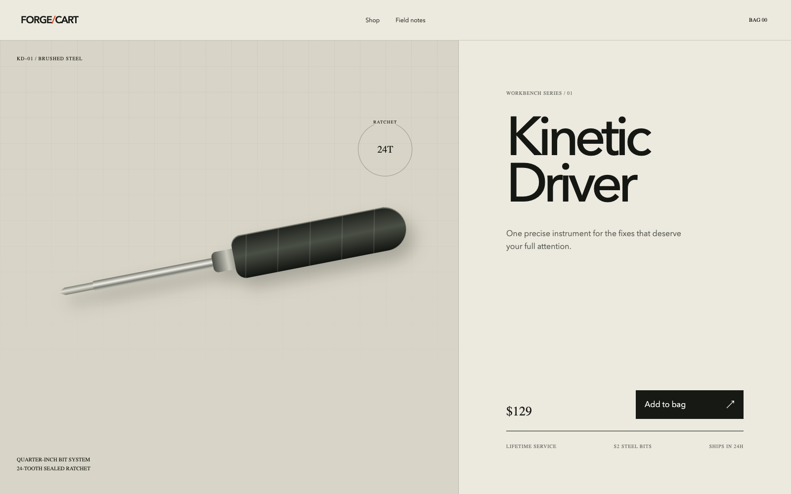
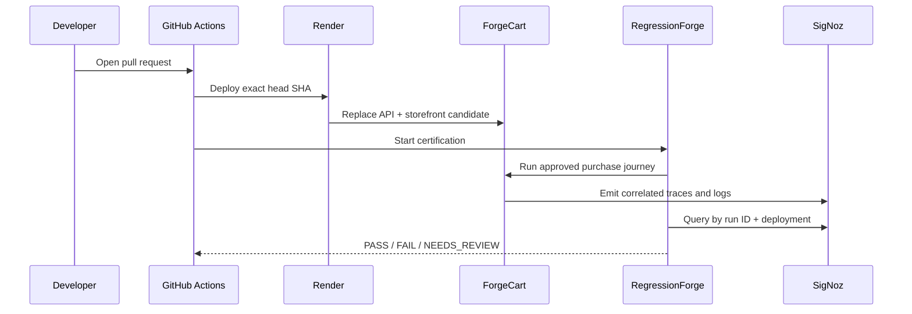

<div align="center">

# ForgeCart

### The e-commerce app built to break like production.

**A polished React + FastAPI storefront with real orders, SMTP email, fulfillment webhooks, OpenTelemetry, and a checkout regression you can ship from a pull request.**

[Open the live store](https://forgecart-storefront.onrender.com) · [Meet RegressionForge](https://github.com/KaushikSiva/regression-forge) · [Open the evidence room](https://regressionforge-evidence-room.onrender.com)


</div>



<p align="center"><sub>A real browser target—not a mocked fixture. Add to bag, check out, persist the order, send the email, notify fulfillment, and trace the entire journey.</sub></p>

## Why ForgeCart exists

Most testing demos fail by toggling a fake flag. ForgeCart creates the failure through a real backend contract change:

```diff
 class CheckoutPayload(BaseModel):
-    total_cents: int
+    amount_cents: int
```

The unchanged storefront still submits `total_cents`. The broken candidate returns HTTP 500, persists no order, sends no email, triggers no fulfillment webhook, and emits a correlated OpenTelemetry error to SigNoz.

That makes ForgeCart the golden target for [RegressionForge](https://github.com/KaushikSiva/regression-forge): one small pull request produces a realistic, inspectable post-deployment regression.

## Create the demo PRs

From a clean `main` checkout:

```bash
./scripts/create-good-pr.sh
./scripts/create-broken-pr.sh
./scripts/create-fixed-pr.sh
```

Each script creates a timestamped branch, makes one contract change, pushes it, and opens a GitHub pull request.

| Script | Candidate contract | Expected gate |
|---|---|---:|
| `create-good-pr.sh` | Accepts the storefront's `total_cents` request | `PASS` |
| `create-broken-pr.sh` | Requires only `amount_cents` | `FAIL` |
| `create-fixed-pr.sh` | Accepts both names without breaking callers | `PASS` |

Add `--dry-run` to inspect the exact diff without pushing a branch or opening a PR.

## What happens after `git push`



The required GitHub check is named **Deployment Certification**. A broken PR is supposed to be red: the failed check is the product working correctly.

## The system is intentionally small—and fully real

| Surface | Implementation |
|---|---|
| Storefront | React, Vite, and an editorial product-detail experience |
| Checkout API | FastAPI with versioned Pydantic request contracts |
| Order persistence | SQLite on a persistent Render disk |
| Confirmation email | SMTP delivery to a real Mailpit server and UI |
| Fulfillment | Real HTTP webhook into RegressionForge's receiver |
| Correlation | `traceparent`, `x-regressionforge-run-id`, and `x-deployment-version` |
| Observability | OpenTelemetry spans and logs exported to self-hosted SigNoz |
| Deployment | Docker + Render, driven by exact pull-request SHAs |
| Code review | Greptile GitHub App scoped to this repository |

## The purchase journey

RegressionForge exercises the same approved workflow for every release:

1. Open ForgeCart.
2. Add the Kinetic Driver to the bag.
3. Enter customer details and submit checkout.
4. Verify the confirmation screen.
5. Verify the correlated order through the public API.
6. Verify the confirmation message in Mailpit.
7. Verify the fulfillment webhook.
8. Verify correlated SigNoz error logs.

The full workflow contains 11 deterministic steps and produces screenshots, WebM video, a Playwright trace, network records, and side-effect evidence under one run ID.

## Run the complete stack locally

Clone this repository beside RegressionForge:

```bash
git clone https://github.com/KaushikSiva/regression-forge.git
git clone https://github.com/KaushikSiva/demo-ecom-store.git
cd regression-forge

make demo
```

Open:

| Surface | Local URL |
|---|---|
| ForgeCart | <http://localhost:4310> |
| ForgeCart API | <http://localhost:4301/docs> |
| RegressionForge evidence room | <http://localhost:4410> |
| RegressionForge API | <http://localhost:4400/docs> |
| Mailpit | <http://localhost:8025> |

Then ship the regression and its repair:

```bash
make deploy-broken
make deploy-fixed
```

## Repository map

```text
backend/
  forgecart/
    contracts/       # baseline, broken, fixed request contracts
    main.py           # checkout, orders, health, OTel setup
frontend/
  src/                # storefront and correlated checkout client
observability/
  signoz/             # Render-ready SigNoz components
scripts/
  cloud_certify.py    # exact-SHA Render deployment + RF gate
  create-*-pr.sh      # one-command demo PR generators
.github/workflows/
  regressionforge.yml # required PR certification check
render.yaml           # ForgeCart, Mailpit, and SigNoz Blueprint
```

## Cloud configuration

The GitHub Actions workflow needs these repository variables:

- `RENDER_FORGECART_API_SERVICE_ID`
- `RENDER_FORGECART_WEB_SERVICE_ID`
- `REGRESSIONFORGE_API_URL`
- `FORGECART_API_URL`
- `FORGECART_STOREFRONT_URL`

And these repository secrets:

- `RENDER_API_KEY`
- `REGRESSIONFORGE_CI_TOKEN`

Install the Greptile GitHub App for only this repository. Keep its API key on the RegressionForge service—not in this repository or its Actions secrets.

For the full Render order, service sizing, SigNoz bootstrap, rollback, and cleanup, see the [RegressionForge cloud guide](https://github.com/KaushikSiva/regression-forge/blob/main/docs/RENDER_CLOUD.md).

---

<div align="center">

**ForgeCart is the failure you can see. RegressionForge is the proof you can trust.**

</div>
